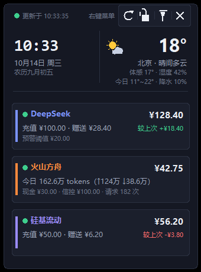

# DeskPulse 桌面看板

一款 Windows 桌面悬浮小工具：把 **时钟日历（含农历与节日）、当天实时天气、多个大模型平台的余额 / 用量** 集中在一张紧凑卡片上。单文件 Python 程序，纯本地运行，只在刷新数据时请求各平台官方接口。

> **许可：PolyForm Noncommercial License 1.0.0 —— 允许个人学习、研究、使用、修改和分发，禁止任何商业用途。** 详见 [LICENSE](LICENSE)。

## 功能

- **时钟日历**：大时钟（秒可开关）、日期、星期、农历与节日
- **实时天气**：温度、体感、湿度、风向、今日高低温、降水概率
- **平台余额 / 用量**：DeepSeek、火山方舟、硅基流动、Kimi、智谱 GLM、WorkBuddy 积分
- **多账户**：每类平台可添加多个账户，账户区自动滚动
- **余额预警**：低于阈值时状态点变红 + 显示「余额不足」徽章
- **变化对比**：与上次刷新对比显示「较上次 ±¥x」，涨绿跌红
- **外观**：6 套护眼配色、85%–160% 缩放、透明度、置顶、锁定、位置记忆、开机自启
- **快捷键**：`Ctrl+Alt+S` 打开设置，`Ctrl+Alt+Q` 退出（均可自定义）
- **隐私**：密钥只保存在本机 `config.json`，程序不会把密钥发往对应平台官方接口以外的任何地方

## 运行

需要 Windows + Python 3.8 以上（只用标准库，无需 `pip install`）：

```
python desktop_widget.py
```

首次运行会在程序同目录自动生成 `config.json`；也可以先复制模板：

```
copy config.example.json config.json
```

打包成单文件 exe（可选）：

```
python -m pip install pyinstaller
pyinstaller --noconsole --onefile --icon app.ico --name DeskPulse desktop_widget.py
```

## 界面



*界面示意：图中账户、余额与天气均为**演示数据**，用于展示布局。*

卡片布局：左侧为大时钟与日期农历，右侧为天气；下方每个账户一张卡片，左缘品牌色竖条、右上大余额数字，右侧显示较上次变化。

## 支持的平台

| 平台 | 需要什么 | 显示内容 |
|---|---|---|
| DeepSeek | API Key（`sk-` 开头） | 余额、充值、赠送 |
| 火山方舟 | IAM 密钥（`AKLT` 开头） | 余额、现金 / 信控、今日 tokens |
| 硅基流动 | API Key | 余额、充值、赠送 |
| Kimi（Moonshot） | API Key | 可用余额、现金、代金券 |
| 智谱 GLM | API Key | Token 配额用量百分比（实验性，无公开余额接口） |
| WorkBuddy 积分 | 无需密钥 | 积分余额、连续签到天数（读取本机桌面端登录态） |

各平台密钥获取地址、完整操作说明见 [docs/使用说明.md](docs/使用说明.md)。

## 已知限制

- 火山方舟必须填 IAM 访问密钥（`AKLT` 开头）；`ark-` 开头的是推理 Key，查不了余额
- WorkBuddy 桌面端 5.6.0 起本地凭据改为加密格式，本工具不破解，会如实提示不支持
- 暂不支持 OpenAI / Anthropic / MiniMax：这几家没有公开的轻量余额查询接口

## 目录结构

```
desktop_widget.py      主程序（单文件，Tkinter，无第三方依赖）
app.ico                图标
config.example.json    配置文件模板（密钥留空）
docs/使用说明.md        面向使用者的完整说明
docs/开发文档-v2.md     设计规范与技术方案
tools/                 开发调试脚本（窗口截图、CPU 占用、布局探针、自检）
```

`tools/` 里的脚本是开发期自用的，其中 `_selfcheck.py` 需要额外安装 Pillow，其余只用标准库。

## 密钥安全提醒

`config.json`、`balance_cache.json`、`error.log` 已在 `.gitignore` 中排除，**请不要把它们提交到公开仓库**。如果你曾经把含明文密钥的配置或打包产物分享出去，请立刻到对应平台后台吊销并重新生成密钥。

## 许可

本项目采用 [PolyForm Noncommercial License 1.0.0](LICENSE) 授权：任何非商业目的（个人使用、研究、学习、慈善 / 教育 / 政府机构使用）均可自由使用、修改和分发；**商业用途需另行获得授权**。

Copyright (c) 2026 youkangduan2008-sys